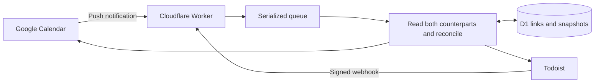

# Google Calendar ↔ Todoist Sync

Self-hosted, webhook-driven two-way sync between multiple Google calendars and Todoist projects. Each calendar maps to one project. Runs on Cloudflare Workers, D1, Queues and Secrets Store; no always-on server is needed.

**Status: personal-use beta.** The core has automated integration tests and live acceptance testing. Setup requires your own Google and Todoist developer apps. It is not an official Google/Todoist product or a hosted service.

## What it does

- Creates and updates real Todoist tasks from Google events, and Google events from scheduled tasks.
- Supports multiple explicit calendar → project pairs; unmapped calendars and projects are ignored.
- Uses Google push notifications and Todoist webhooks, with periodic recovery for missed notifications.
- Preserves Google events when tasks are completed or reopened.
- Syncs confirmed deletions and moves between mapped calendars/projects when enabled.
- Keeps equivalent simple recurring schedules native in both providers. Complex Google rules and exceptions use individual occurrence tasks. Other Todoist rules stay native in Todoist, with separate Google events as the task advances.
- Retains completed Google occurrences, including after several rapid recurring completions.
- Handles timed/all-day items and timezone changes; new imports use a rolling 90-day window whose day boundary is currently Europe/London.
- Provides authenticated status/review commands and optional Gmail send-only failure/recovery alerts.

## How it works



Links, snapshots, deterministic event IDs and durable operation journals suppress echoes and make retries safe. Conflicting edits pause the affected pair for review. OAuth credentials live in Cloudflare secret storage, separately from D1.

[Architecture and code guide](docs/ARCHITECTURE.md) · [Exact behaviour](docs/DECISIONS.md)

## Get started

You need Node.js 26+, a Cloudflare account, a Google Cloud OAuth web client, and a Todoist developer app. The OAuth helper currently opens a browser using macOS `open`; other operating systems need an equivalent local browser-launch adaptation.

```sh
npm ci
npm run init:local
```

This creates three **ignored, owner-only** files without overwriting an existing installation:

| File                         | Purpose                                                                 |
| ---------------------------- | ----------------------------------------------------------------------- |
| `wrangler.local.jsonc`       | Your Worker name, Cloudflare resource IDs, URL and operational settings |
| `config/mappings.local.json` | Your Google calendar ↔ Todoist project mappings                         |
| `.dev.vars`                  | Local OAuth client credentials and administrative secrets               |

Then follow the [complete setup guide](docs/SETUP.md), starting with a dedicated test calendar and project. Fill in the private templates, provision Cloudflare resources, deploy the paused bootstrap, register/authorize the provider apps, then enable syncing.

**Do not deploy the example IDs or point an untested installation at your main calendar.** The checked-in `wrangler.jsonc` is a portable template and has syncing disabled.

An example mapping looks like this:

```json
{
  "mappings": [
    {
      "id": "work",
      "googleCalendarId": "REPLACE_WITH_GOOGLE_CALENDAR_ID",
      "todoistProjectId": "REPLACE_WITH_TODOIST_PROJECT_ID",
      "extendedRecurrence": true,
      "complexRecurrence": true,
      "mappedMoves": false,
      "deleteTasksOnGoogleDeletion": false,
      "deleteGoogleOnTaskDeletion": false
    }
  ]
}
```

`npm run deploy` uploads the private mappings as a **Cloudflare Worker secret** alongside the code. It preserves existing provider secrets and removes the temporary upload file afterward. No credentials, real mapping IDs or personal deployment settings belong in Git.

## Commands

| Command                         | Purpose                                                                               |
| ------------------------------- | ------------------------------------------------------------------------------------- |
| `npm run check`                 | Type-check Worker code                                                                |
| `npm test`                      | Unit/security and provider-simulated integration tests using local D1                 |
| `npm run build`                 | Compile the public template without deploying or needing personal configuration       |
| `npm run format:check`          | Check formatting                                                                      |
| `npm run dev`                   | Run locally using your private configuration and `.dev.vars`                          |
| `npm run deploy -- --bootstrap` | Deploy a paused Worker before first OAuth authorization                               |
| `npm run deploy`                | Deploy code plus private mapping secret to your configured Worker                     |
| `npm run status`                | Read deployed health, recovery timestamps and email delivery state                    |
| `npm run reconcile`             | Explicitly queue recovery for enabled mappings                                        |
| `npm run privacy:check`         | Audit eligible files and all Git history for credential patterns/local private values |
| `npm run review`                | Inspect saved summaries of held pairs; makes no changes                               |
| `npm run usage`                 | Read Cloudflare account usage and queue depths                                        |
| `npm run cf -- <command>`       | Run Wrangler against your ignored local deployment configuration                      |

Tests simulate provider APIs; passing tests does not prove webhook latency, provider quota availability or free-tier capacity. See [testing](docs/TESTING.md) and [usage](docs/USAGE.md).

## Behaviour to understand before enabling writes

- **Completion is not deletion.** Completing/reopening a task leaves existing Google events unchanged. A recurring completion may create the next Google occurrence.
- **Deletion can be destructive.** The two propagation flags default off in the example. Enable each only after testing. Deleting a native recurring task can remove its linked Google series; deleting an occurrence task affects its individual instance.
- **Recurrence has two representations.** Simple compatible pairs use native rules. Complex Google series use tasks per occurrence; converting an existing native pair retains its current task identity. Tasks already completed before conversion are not recreated.
- **Conflicts require review.** Simultaneous edits, ambiguous move candidates, missing history, undated linked tasks and unsupported changes can hold a pair instead of guessing.
- **This is not a backup.** Keep independent provider exports. Do not run another integration that writes the same items without understanding its interactions.

There is no automatic title-only matching of pre-existing items, large-load guarantee, or guaranteed update deadline. Webhooks target updates within seconds after delivery; provider delays and queue backlogs can make them slower. Recovery runs every 15 minutes for Google and every six hours for full project/link/window scans.

## Hosting cost and privacy

Designed for a small personal workload within Cloudflare's free allowances, without enabling a paid plan. Recovery, retries and occurrence expansion all consume operations. Check your own plan and measured usage; this repository does not guarantee zero cost at every workload. [Budget and monitoring guide](docs/USAGE.md).

D1 contains task/event content snapshots and recovery metadata; it must be treated as private data. Public app/privacy pages expose no calendar content, and administrative endpoints require a Bearer token. Optional email alerts contain mapping names and operational reasons, not task titles or descriptions. They depend on the Worker, D1 and Google authorization, so they cannot independently report a total outage. [Security guidance](SECURITY.md).

## Contributing

See [CONTRIBUTING.md](CONTRIBUTING.md). Bug reports should use synthetic examples and redacted status output. Never attach `.dev.vars`, private configuration, database exports, OAuth callback URLs or raw request logs.

Official references: [Google push notifications](https://developers.google.com/workspace/calendar/api/guides/push), [Google incremental sync](https://developers.google.com/workspace/calendar/api/guides/sync), [Todoist API](https://developer.todoist.com/api/v1/), [Cloudflare Workers](https://developers.cloudflare.com/workers/), [Queues pricing](https://developers.cloudflare.com/queues/platform/pricing/).
